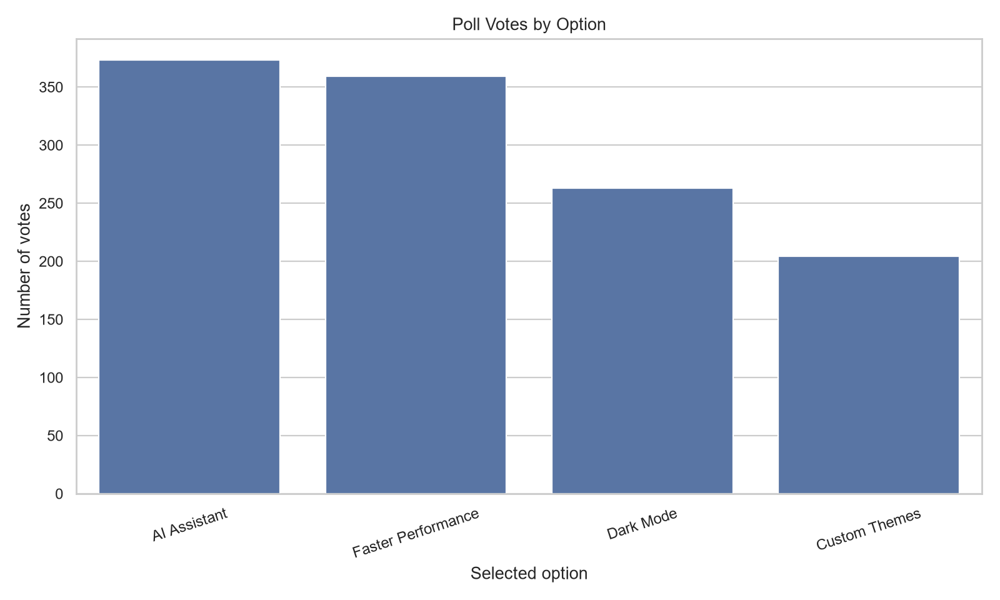
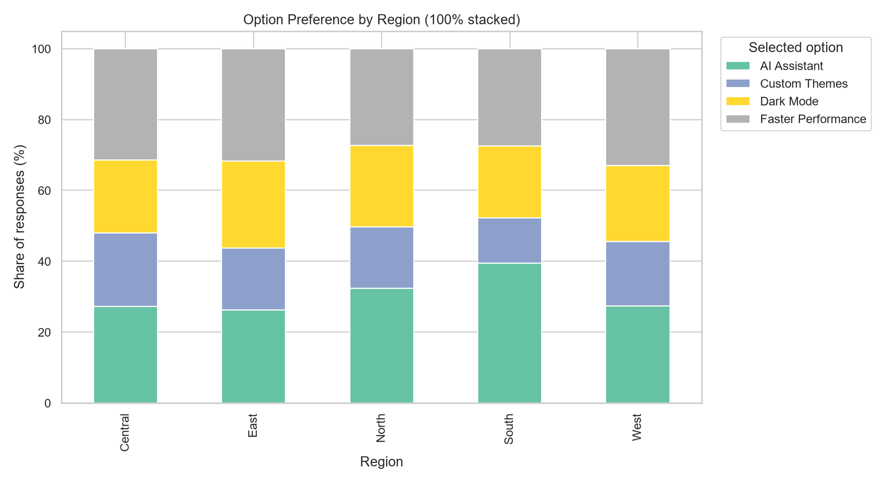

# Poll Results Visualizer

A beginner-friendly, portfolio-ready Python project that cleans poll responses, calculates vote shares, compares regions and age groups, creates charts, and generates descriptive insights. Includes a command-line analysis pipeline and an interactive Streamlit dashboard.

> **Data note:** The built-in dataset is synthetic and fictional. Do not present its results as real public opinion or real election polling.

## Features

- Generate reproducible synthetic poll data or load a CSV export.
- Validate required columns and parse dates.
- Normalize text categories and remove duplicate respondent IDs.
- Calculate option-wise vote counts and response percentages.
- Compare option preferences by region and age group.
- Visualize votes, shares, regional patterns, demographic differences, and weekly response volume.
- Export cleaned responses, summary CSV files, a cleaning report, and automated insights.
- Explore data interactively with Streamlit filters.
- Run basic automated tests with pytest.

## Tech stack

Python, Pandas, NumPy, Matplotlib, Seaborn, Streamlit, pytest, Git, and GitHub.

## Project structure

```text
Poll-Results-Visualizer/
├── data/                 # Generated or user-supplied CSV data
├── images/               # Generated chart images
├── notebooks/            # Optional Jupyter analysis
├── outputs/              # CSV summaries, cleaning report, insights
├── src/
│   └── poll_visualizer.py
├── tests/
│   └── test_poll_visualizer.py
├── app.py                # Interactive dashboard
├── main.py               # Command-line pipeline
├── requirements.txt
└── README.md
```

## Installation

Python 3.11 or 3.12 is recommended.

### Windows PowerShell

```powershell
cd "D:\Projects\Poll-Results-Visualizer"
py -3.12 -m venv .venv
.\.venv\Scripts\Activate.ps1
python -m pip install --upgrade pip
python -m pip install -r requirements.txt
```

If PowerShell blocks activation, use the venv's Python directly:

```powershell
.\.venv\Scripts\python.exe -m pip install -r requirements.txt
```

### macOS / Linux

```bash
cd Poll-Results-Visualizer
python3 -m venv .venv
source .venv/bin/activate
python -m pip install --upgrade pip
python -m pip install -r requirements.txt
```

## Run the analysis

Generate a fresh sample dataset and analyze it:

```bash
python main.py --generate
```

Or load your own CSV:

```bash
python main.py --input "data/my_poll.csv"
```

The input CSV must contain these columns:

| Column | Meaning | Example |
|---|---|---|
| `respondent_id` | Unique respondent identifier | R00001 |
| `response_date` | Response date | 2026-02-15 |
| `question` | Poll question | Which feature do you prefer? |
| `selected_option` | Chosen answer | Dark Mode |
| `region` | Broad region | North |
| `age_group` | Age category | 18-24 |
| `gender` | Optional demographic category | Woman |

For a Google Forms export, rename or map the relevant columns to this schema before running. Never include names, email addresses, phone numbers, or other direct identifiers in a public repository.

## Run the dashboard

```bash
python -m streamlit run app.py
```

Upload a CSV using the file uploader or use the built-in synthetic example. Filter by region and age group, inspect summaries, and download results.

## Outputs

Running `main.py` creates:

- `data/synthetic_poll_responses.csv`
- `outputs/cleaned_poll_responses.csv`
- `outputs/option_summary.csv`
- `outputs/region_counts.csv`
- `outputs/region_pct.csv`
- `outputs/age_counts.csv`
- `outputs/age_pct.csv`
- `outputs/trend.csv`
- `outputs/cleaning_report.json`
- `outputs/insights.txt`
- `images/vote_bar_chart.png`
- `images/vote_pie_chart.png`
- `images/region_stacked_chart.png`
- `images/demographic_heatmap.png`
- `images/response_trend.png`

Percentages in region and age comparisons use the responses within each group as the denominator. This makes it easier to compare preference distributions when group sizes differ.

## Example interpretation

The script identifies the most selected option in the dataset and reports its vote count and percentage. Exact results are generated from the dataset at runtime; do not hardcode example results into a report. Because the included data is fictional, the output demonstrates the workflow rather than a real market finding.

## Data quality and limitations

- Duplicate respondent IDs are removed, keeping the first row.
- Rows missing required fields or containing invalid dates/options are removed.
- Missing demographic values are labelled `Unknown`.
- A respondent is treated as one vote in this example. Multi-select polls require a different denominator and analysis.
- The current dashboard analyzes a single question per dataset. Multi-question surveys can be supported by adding a question selector.
- Results are descriptive, not causal. Population claims require a sound sampling design and may require weighting or uncertainty estimates.

## Run tests

```bash
python -m pip install pytest
python -m pytest -q
```

## Screenshots

After running the project, add your genuine screenshots to `images/` and embed them here, for example:

```markdown


```

## Future improvements

- Support multiple questions and multi-select polls.
- Add confidence intervals and sample-size warnings.
- Add open-text sentiment analysis with privacy safeguards.
- Connect to an API or database for recurring survey data.
- Add Plotly charts and deploy the dashboard.
- Build a Power BI report using exported summary tables.

## Author

Student portfolio project — built for practical data analytics learning.
